# MH Launcher – Marvel Heroes on Linux & Steam Deck

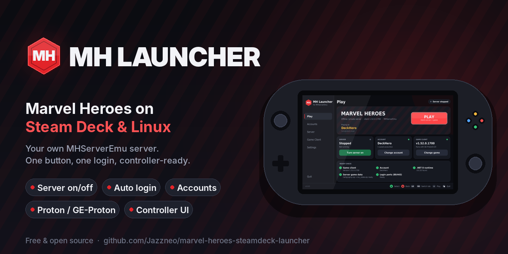

**[⬇ Download the latest release](https://github.com/Jazzneo/marvel-heroes-steamdeck-launcher/releases/latest)**: get `MHLauncher-linux-x64.tar.xz`. It's ready to run, with Python and the MHServerEmu server bundled. Works on Steam Deck (SteamOS), Bazzite and other x86-64 Linux distros.

MH Launcher is an all-in-one launcher for **MHServerEmu**, the Marvel Heroes private server. It lets you:

* **Turn the server on and off** with one button. It shuts down safely, so player data is always saved.
* **Sign in** from the launcher. PLAY starts the server if needed and logs you into the game automatically.
* **Create accounts** (and optionally give them admin rights) without touching a console or a website.
* **Pick your Marvel Heroes EXE**, or let the launcher search for it. It checks that the client is version 1.52.0.1700 and copies the game data the server needs.
* Run the Windows game through **Proton** (Valve's Proton, Proton Experimental, GE-Proton, or `umu-run`) or **Wine**.
* **Play with a friend:** host your server for friends, or join theirs. It works on the same network, over Tailscale/ZeroTier, or over the internet with automatic router port forwarding (UPnP).
* **Install mods** (costumes, icons, text, sound packs) from a controller-friendly **Mods** tab, powered by [MHO Extended Mod Manager](https://github.com/leeper48/MHO-UPK-Tools).
* Play **with a controller** on Steam Deck. Navigation, an on-screen keyboard, a file browser and Gaming Mode support are all built in.

It doesn't need Apache. The launcher has its own small "login bridge" that does what Apache does in the Windows setup: it serves `SiteConfig.xml` and forwards logins to the server.

---

## Screenshots

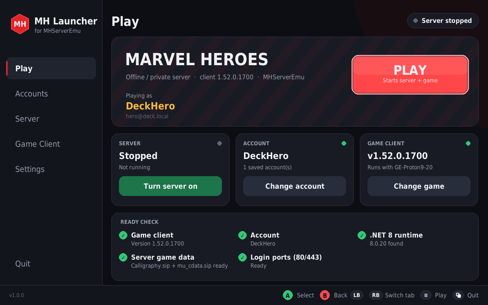

| Friends | Mods | Install a mod |
| --- | --- | --- |
| 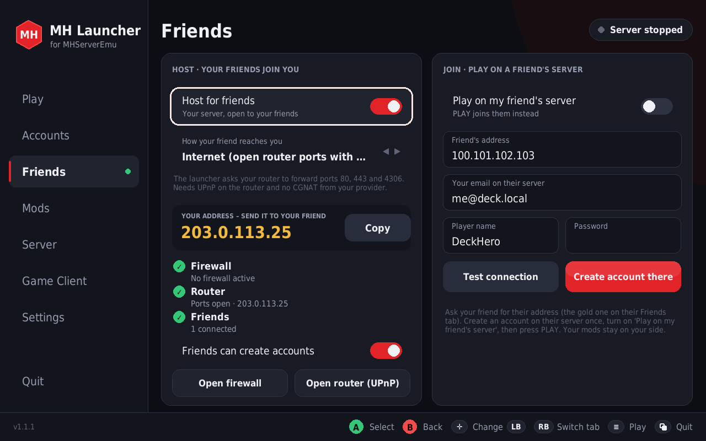 | 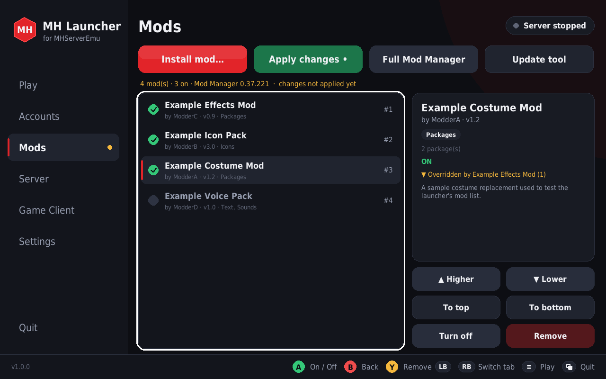 | 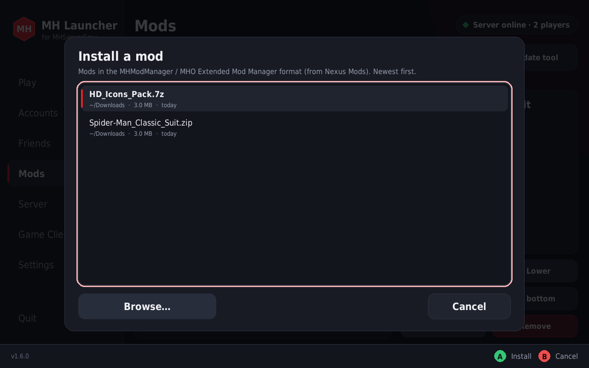 |

| Accounts | Server | Game client |
| --- | --- | --- |
| 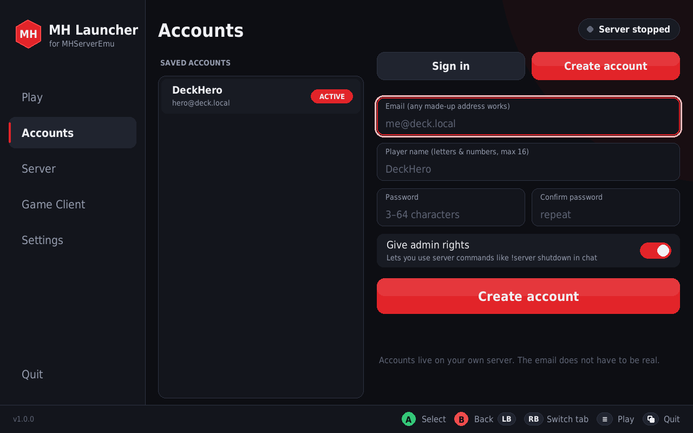 | 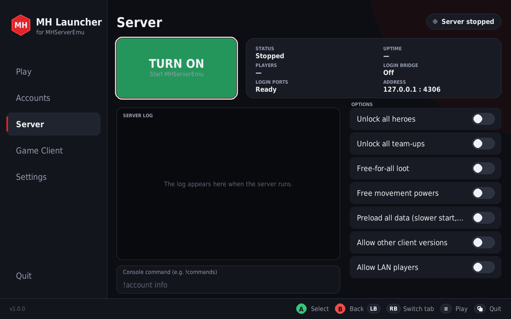 | 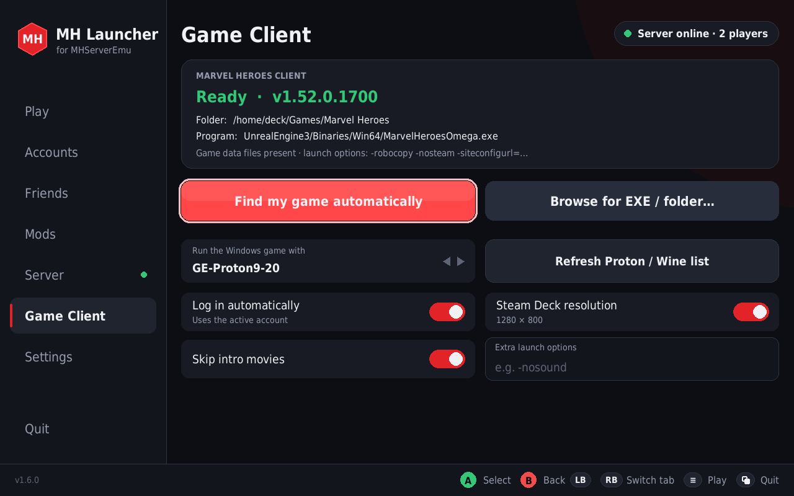 |
| **Settings** | **On-screen keyboard** | **Saved accounts** |
| 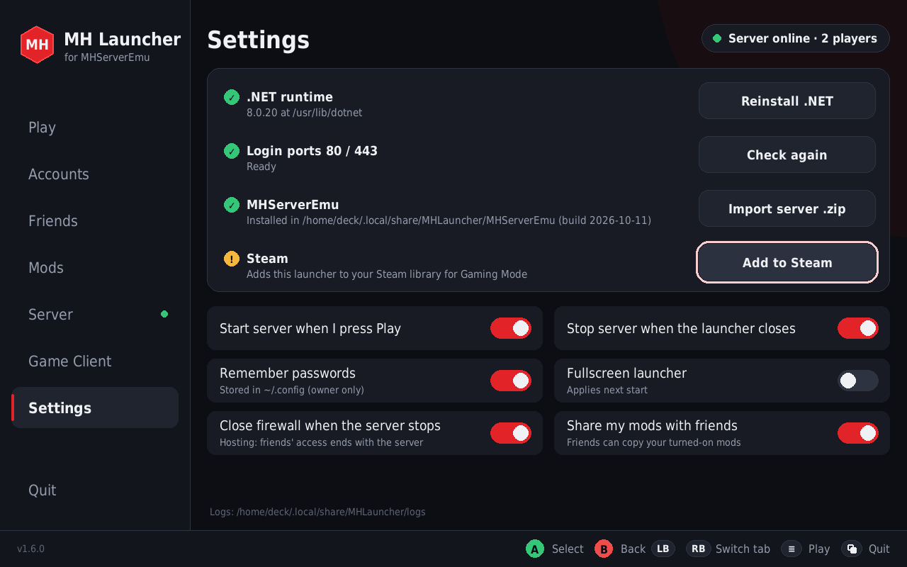 | 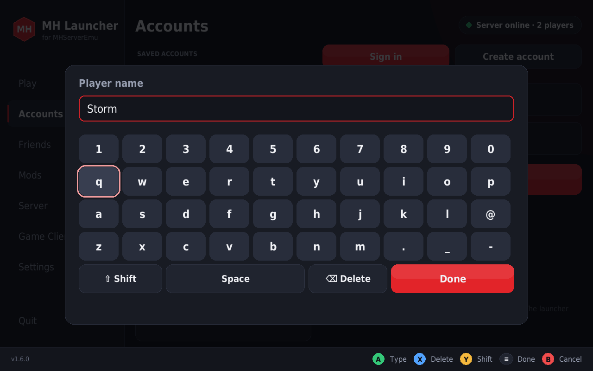 | 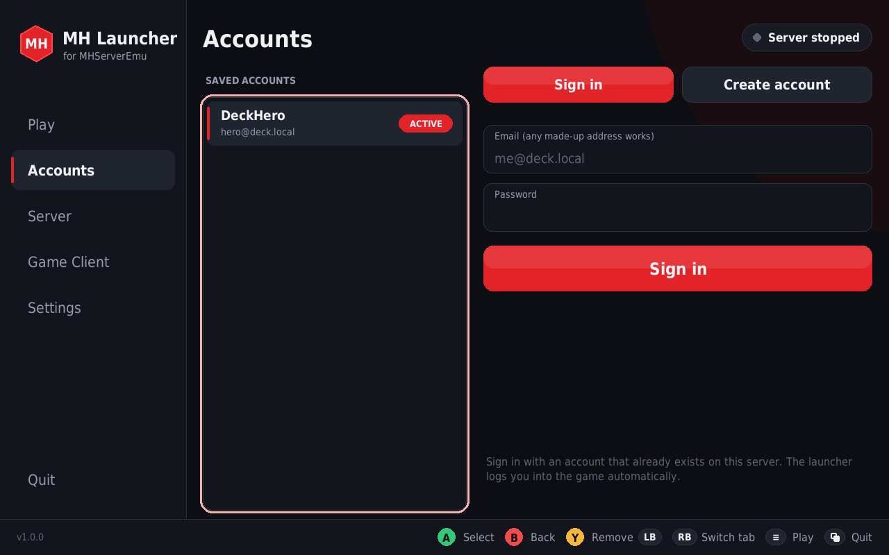 |

## What's in the download

| Path | What it is |
| --- | --- |
| `MHLauncher.sh` | Start the launcher with this |
| `app/` | Launcher source code (Python + pygame) |
| `runtime/` | Bundled Python 3.12 + pygame-ce. Works on any distro, no installs needed |
| `server/` | MHServerEmu nightly 2026-10-10 (linux-x64). Copied to your data folder on first start |
| `tools/enable-login-ports.sh` | One-time port setup (see step 2) |
| `assets/` | Icon, SiteConfig template, self-signed certificate for the login bridge |

## Setup (Steam Deck: do this in Desktop Mode)

1. **Extract `MHLauncher-linux-x64.tar.xz`** somewhere permanent, for example `~/Games/` (Dolphin: right-click → Extract → Extract archive here; or `tar -xf MHLauncher-linux-x64.tar.xz -C ~/Games`). That gives you `~/Games/MHLauncher`.
2. **One-time port setup.** The game client always logs in on ports **80/443**, and Linux reserves ports below 1024 for root. Open Konsole and paste:
   ```bash
   passwd    # Steam Deck only, if you never set a password
   echo 'net.ipv4.ip_unprivileged_port_start=80' | sudo tee /etc/sysctl.d/60-mhlauncher.conf
   sudo sysctl -w net.ipv4.ip_unprivileged_port_start=80
   ```
   **Easier:** just press PLAY. When the ports aren't set up yet, the launcher offers **Fix it for me**, asks for your password once and does it. (If no password pop-up can appear, e.g. in Gaming Mode on some systems, use the commands above or do it once from Desktop Mode.) To undo: `sudo rm /etc/sysctl.d/60-mhlauncher.conf` and reboot.
3. **Start the launcher:** double-click `MHLauncher.sh`, or run it from a terminal.
4. **Game Client tab → Find my game automatically**, or **Browse** to `MarvelHeroesOmega.exe`. It's in `Marvel Heroes/UnrealEngine3/Binaries/Win64/`, and you can also just pick the `Marvel Heroes` folder.
5. **Accounts tab → Create account.** The email doesn't need to be real (e.g. `me@deck.local`). The server starts automatically. Leave **Give admin rights** on for your own account.
6. **Settings → Add to Steam** puts the launcher in your Steam library so you can use it from Gaming Mode.
7. Press **PLAY**.

The first PLAY downloads the .NET 8 runtime (about 30 MB, no admin needed) if your system doesn't have .NET 8 or newer. It also creates a Proton prefix, which takes a minute.

## Controls

| Steam Deck / gamepad | Keyboard | Action |
| --- | --- | --- |
| D-pad / left stick | Arrow keys, Tab | Move |
| A | Enter / Space | Select, type a key |
| B | Esc | Back / close |
| X | – | Delete (on-screen keyboard) |
| Y | Delete | Remove saved account / Shift / pick folder |
| LB / RB | Page Up / Page Down | Switch tab |
| ≡ (Menu) | F5 | **Play** |
| ⧉ (View) | Ctrl+Q | Quit |
| LT / RT, mouse wheel | – | Scroll lists and the server log |

The touchscreen and trackpads work too. Text fields open a controller-friendly keyboard; a real keyboard, or Steam's keyboard (STEAM + X), types into it directly.

## The tabs

* **Play** – the big PLAY button, server/account/client status, and a "ready check" with Fix buttons.
* **Accounts** – saved accounts (choose the active one, Y to remove), Sign in, Create account.
* **Friends** – **Host for friends** (your address to share, firewall/router helpers, friends online) and **Join** (your friend's address, create an account on their server, test the connection, play on their server). See [Playing with friends](#playing-with-friends).
* **Mods** – your mod list: **A** turns a mod on/off, move mods higher/lower (the higher mod wins when two change the same file), **Install mod…** (newest downloads first, or Browse), **Apply changes**, **Remove**, and **Full Mod Manager** for the editor and Nexus features. See [Mods](#mods) below.
* **Server** – ON/OFF, live log, a console command box (e.g. `!commands`, `!account userlevel me@deck.local 2`), and options written to `ConfigOverride.ini`: unlock all heroes/team-ups, free-for-all loot, free movement powers, preload data, allow other client versions, allow LAN players.
* **Game Client** – client path and version, which Proton/Wine to use (or a custom command with `{exe}` and `{args}`), auto-login, 1280×800 resolution, skip intro movies, extra launch options.
* **Settings** – install .NET, port status, import a newer server zip (your accounts are kept), Add to Steam, launcher behaviour.

## Playing with friends

One of you **hosts** (runs the server) and the other **joins**. Both need MH Launcher and their own copy of the game.

**Choosing how your friend reaches you** (Friends tab → *How your friend reaches you*):

| Way | Best for | What you need |
| --- | --- | --- |
| **Tailscale** (recommended) | Playing over the internet | Both install [Tailscale](https://tailscale.com/download) (built into Bazzite). Press **Set up Tailscale** on the Friends tab: it turns Tailscale on and opens the login page. The host then invites the friend to their tailnet, or shares this machine with them. No router setup. |
| **Deck to Deck (own Wi-Fi hotspot)** | Two Decks side by side, no router or internet (car, travel, outdoors) | Nothing extra. The host's Deck makes its own Wi-Fi; the other Deck presses **Find Deck**. See [Deck to Deck](#deck-to-deck-no-router). |
| **Same Wi-Fi / home network** | Same house | Nothing extra |
| **ZeroTier** | Over the internet, like Tailscale | Both join the same ZeroTier network |
| **Internet (UPnP)** | No VPN wanted | A router with UPnP turned on, and no CGNAT from your provider (the launcher warns you if there is) |

**Host:**
1. Friends tab → turn on **Host for friends** and pick how your friend reaches you.
2. If asked, press **Open it**. One password prompt lets ports 80, 443 and 4306 through your firewall (firewalld/ufw) and does the one-time port setup.
3. Send your friend the **gold address**. **Copy** puts it on the clipboard.
4. Press **PLAY** as usual. Your server runs and your friend can join while it's on.

**Friend (joining):**
1. Friends tab → type the host's address in **Friend's address** and press **Test connection**.
2. Enter an email, player name and password, then press **Create account there**. This makes an account on the host's server.
3. Turn on **Play on my friend's server** and press **PLAY**. The game logs in to the host's server automatically.

### Deck to Deck (no router)

Two Steam Decks can play together with nothing else: one Deck makes its own Wi-Fi hotspot and the other joins it directly. (The Deck's Wi-Fi can't do the old "ad-hoc" mode, so the launcher uses a hotspot instead; it works the same way and is more reliable.)

**Host Deck:**
1. Friends tab → *How your friend reaches you* → **Deck to Deck (own Wi-Fi hotspot)**, then turn on **Host for friends** (or press **Start hotspot**).
2. The box shows the **Wi-Fi name** (`MHL-…`) and an 8-digit **password**. **New password** makes a new one.
3. Press **PLAY** as usual.

**Joining Deck:**
1. Friends tab → **Find Deck** → pick your friend's Deck → type the password.
2. The launcher connects, fills in the address (`10.42.0.1`) and turns on **Play on my friend's server**.
3. The first time, enter an email, player name and password and press **Create account there**. Then press **PLAY**.

While the hotspot is on (or joined), that Deck's Wi-Fi isn't on your normal network, so there's no internet. The game and server don't need it. Your usual Wi-Fi comes back by itself when you stop hosting, press **Leave Deck**, turn off *Play on my friend's server*, or close the launcher. If the launcher crashed, it switches the Wi-Fi back the next time it starts. Keep the Decks within a few metres for the best connection; the hotspot uses 2.4 GHz for range and works with both the LCD and OLED Deck. It also works on Linux PCs and laptops that use NetworkManager and have Wi-Fi.

**How it works:** the launcher's login bridge answers each player with the address they actually used. The host's own game gets `127.0.0.1`, and the friend gets the LAN, Tailscale or internet address. It does this for SiteConfig.xml and for the login ticket's game-server address, so one server works for everyone without editing any config.

**Security:** friends can only reach the login, SiteConfig, server status and (if you allow it) account creation. The dashboard and the admin web API stay local. Turn off **Friends can create accounts** to stop new sign-ups. Router ports opened with UPnP are closed again when you stop hosting, and the **firewall closes by itself** when you turn off hosting, when the server stops, or when the launcher closes (even after a crash) – no password needed. It only removes the rules it added, and with firewalld the rules are temporary, so a reboot clears them too. You can also press **Close firewall** on the Friends tab any time.

## Mods

The Mods tab is a controller-friendly front end for **[MHO Extended Mod Manager](https://github.com/leeper48/MHO-UPK-Tools)** by leeper48 (MIT). The launcher shows and orders your mod list itself. Everything that touches game files is done by the real Mod Manager through its command line (`--install`, `--apply`, `--remove`), run with the same Proton/Wine as the game. That keeps its safety net intact: every game file is rebuilt from a verified original, turning a mod off puts the original back, and it refuses to write while the game runs.

1. **Mods → Set up Mod Manager** (one time). This downloads the newest MHO Extended Mod Manager release from GitHub and checks it against its published SHA-256. It also downloads Microsoft's .NET 8 Desktop Runtime for Windows (about 55 MB) and unpacks it into the game's Proton prefix.
2. Download mods from [Nexus Mods (Marvel Heroes Omega)](https://www.nexusmods.com/marvelheroesomega) into `~/Downloads`. The `.zip`, `.7z` and `.rar` mods in the MHModManager format all work.
3. **Install mod…** lists your newest downloads first. A new mod is turned **on** and put at the top.
4. **Apply changes**, or just press **PLAY**: pending mod changes are applied automatically before the game starts.

* **Order matters:** when two mods change the same file, the one **higher** in the list wins. The details panel shows "Wins over …" / "Overridden by …".
* **Remove** takes the mod out of the game first (if it's on), then moves its folder to `~/.local/share/MHLauncher/modmanager/removed/`.
* **Full Mod Manager** opens the original window, with its editor, tags, Nexus update checks and Find My Mods. It uses the same library, so changes show up in the launcher too. It's a Windows desktop app, so use it with a mouse/trackpad.
* **Update tool** installs the newest MHO Extended Mod Manager release.

## Where things are stored

| What | Where |
| --- | --- |
| Server, accounts database (`Data/Account.db`), `ConfigOverride.ini` | `~/.local/share/MHLauncher/MHServerEmu/` |
| .NET runtime (if the launcher installed it) | `~/.local/share/MHLauncher/dotnet/` |
| Proton/Wine prefix for the game | `~/.local/share/MHLauncher/prefix/` |
| Logs (`server.log`, `client.log`, `launcher.log`, `modmanager.log`) | `~/.local/share/MHLauncher/logs/` |
| Mod library (`mods/`, `state.json`), removed mods, Mod Manager app | `~/.local/share/MHLauncher/modmanager/` |
| Launcher settings and saved logins (permissions 600) | `~/.config/MHLauncher/settings.json` |

Back up `Account.db` before big server updates. To update the server, download a newer `MHServerEmu-…-linux-x64.zip`, turn the server off, and use **Settings → Import server .zip**.

## Troubleshooting

* **"Login ports need a one-time setup"**: do step 2. If something else (Apache/nginx) already uses port 443, stop it or let it proxy `/AuthServer` to `localhost:8080`.
* **The game closes right away or shows a black screen**: try another runner on the Game Client tab. GE-Proton or Proton 8/9 tend to work best. Check `logs/client.log`. Some setups need the VC++ runtimes: `protontricks`/`winetricks vcrun2010 vcrun2013` into `~/.local/share/MHLauncher/prefix/pfx`.
* **In-game "Site Config Not Available Due To HttpRequest Error"**: the game could not download SiteConfig.xml. Usually the one-time port setup (step 2) is missing. The launcher now checks ports 80/443 before starting the game and tells you what is wrong.
* **"Login ports blocked" (nginx, Apache, Caddy…)**: press **Fix it for me**. After one password prompt, the launcher stops the web server that holds ports 80/443, turns off its autostart, and opens the ports. To use that web server again later: `sudo systemctl enable --now nginx` (with the launcher closed).
* **"Old server still running" / "Port already in use"**: an earlier MHServerEmu is still running in the background. The launcher detects it and offers to shut it down cleanly. If another program owns port 4306/8080, the launcher names it.
* **The server stops right after starting**: open the Server tab log. The most common cause is game data missing from the client (`Calligraphy.sip`, `mu_cdata.sip`). Re-pick the client so they get copied again.
* **Login fails in game**: check the account on the Accounts tab (Sign in checks the password against the server), and confirm that the "Login bridge" on the Server tab shows *Running*.
* **Playing with friends on your network**: turn on **Allow LAN players** and restart the server. Friends launch the game with `-robocopy -nosteam -siteconfigurl=YOUR-IP/SiteConfig.xml` (no `http://`), and ports 80, 443 and 4306 must not be blocked by a firewall.
* **Friend can't connect**: on the Friends tab, the friend presses **Test connection**. Check that the host is hosting and their server is on, that both are connected to Tailscale/ZeroTier (if used), and that the host pressed **Open firewall**. With *Internet (UPnP)*, CGNAT from the provider makes hosting impossible; use Tailscale instead.
* **A mod doesn't install or apply**: the Mod Manager's full output is in `~/.local/share/MHLauncher/logs/modmanager.log`. It refuses to change files while the game runs, and it leaves alone any game file that another tool changed (it lists those). If the Mods setup fails, start the game once (so Proton creates its prefix) and try again.
* The server's web dashboard is at http://localhost:8080/Dashboard/ while the server is running. If another program (on Steam Deck usually Steam's own `steamwebhelper`) already uses 8080, the launcher moves the server to the next free port (8580, 8680, …) and says so in the server log.

## Notes

* You need your own copy of the Marvel Heroes client (version 1.52.0.1700). It is not included.
* This launcher is an unofficial community tool and is not affiliated with Marvel, Disney or Gazillion.

## Running from source

```bash
git clone https://github.com/Jazzneo/marvel-heroes-steamdeck-launcher.git
cd marvel-heroes-steamdeck-launcher
python3 -m pip install --user pygame-ce   # Python 3.10+
./MHLauncher.sh                           # uses system python3 if there is no runtime/ folder
```

Without the bundled `server/` folder, import a `MHServerEmu-…-linux-x64.zip` with **Settings → Import server .zip**.

## Building a release package

```bash
tools/build-release.sh ~/Downloads/MHServerEmu-nightly-YYYYMMDD-Release-linux-x64.zip v1.0.0
# -> dist/MHLauncher-linux-x64.tar.xz
```

The script downloads a portable CPython build ([python-build-standalone](https://github.com/astral-sh/python-build-standalone)) and the [pygame-ce](https://github.com/pygame-community/pygame-ce) wheel, trims them, and adds the server.

## Credits & licenses

* **MH Launcher** © Jazzneo, licensed under the [GNU GPL v3.0](LICENSE).
* **[MHServerEmu](https://github.com/Crypto137/MHServerEmu)** by Crypto137 and contributors, licensed under the **AGPL-3.0**. Release packages include an unmodified MHServerEmu build together with its license (`server/LICENSE.txt`); its source code is available at the link above.
* **[MHO Extended Mod Manager](https://github.com/leeper48/MHO-UPK-Tools)** by leeper48, licensed under the **MIT** license, building on Krisan's MHModManager format. It is not bundled: the Mods tab downloads the official release on request, and runs it unmodified.
* Bundled fallback font: [DejaVu Sans](https://dejavu-fonts.github.io/) (free license, `assets/fonts/DejaVu-LICENSE.txt`).
* Bundled runtime: [CPython](https://www.python.org/) (PSF License) via python-build-standalone, and [pygame-ce](https://github.com/pygame-community/pygame-ce) (LGPL-2.1).
* Marvel Heroes is a trademark of its respective owners. No game files are included.
